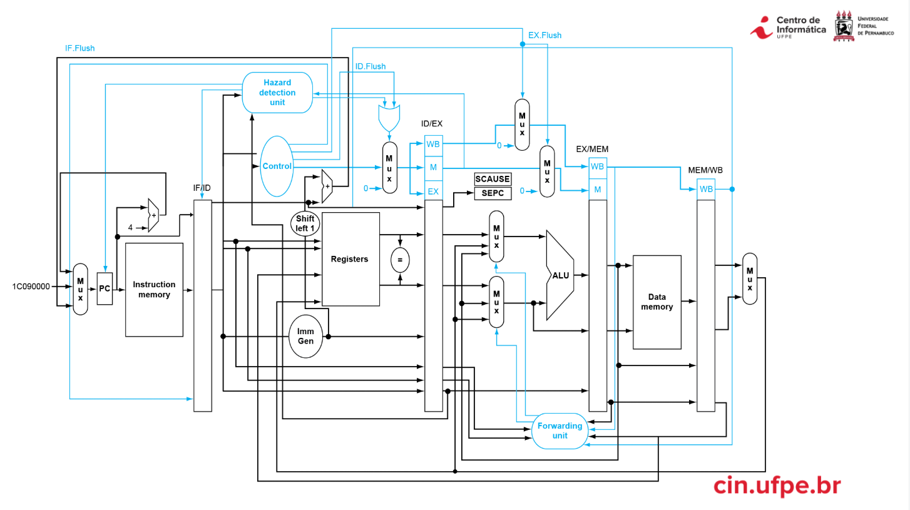
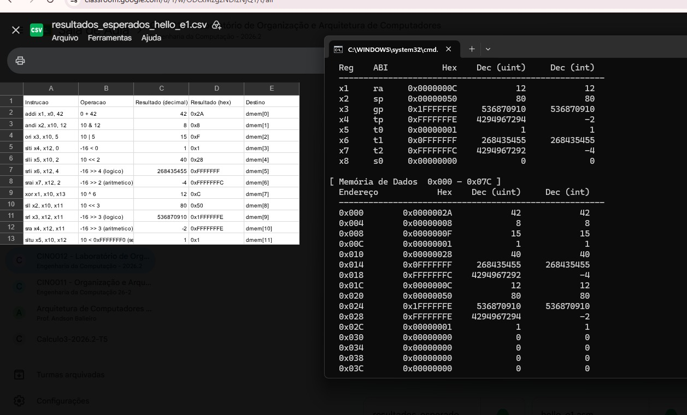
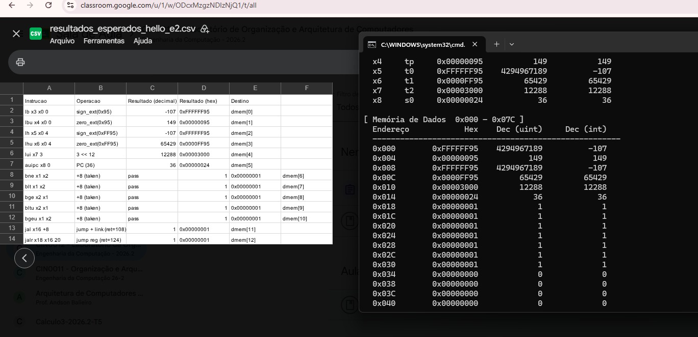

# Relatório do Projeto Final - Processador RISC-V RV32I com Pipeline

Projeto final de CIN0012, Laboratório de Organização e Arquitetura de Computadores (CIn/UFPE, 2026.2).

| Nome | Usuário |
|------|:-------:|
| Alberto Marques dos Santos | ams18 |
| Carolina Santiago de Medeiros | csm6 |
| Ianne Vitória Cruz Fernandes | ivcf |
| Lucas Ferreira Alves | lfa4 |

Professores: Victor Medeiros e Edna Barros

## 1. Introdução

Este projeto implementa, em SystemVerilog, um processador RISC-V RV32I com pipeline de 5 estágios, executado em simulação (ModelSim) e na placa FPGA DE2-115.

O ponto de partida é o [projeto base](https://gitlab.com/jualabs-teaching/oac/rv32i_pipelined_base_project) fornecido pelos professores, construído a partir da versão em pipeline do processador apresentada no livro *Computer Organization and Design RISC-V Edition*, de Patterson e Hennessy. O projeto base executa 8 instruções: ADD, SUB, OR, AND, SLT, LW, SW e BEQ.

O objetivo é estender esse processador para 36 instruções do RV32I, em três etapas, preservando a estrutura do pipeline, e validar o resultado em simulação e em hardware. A estratégia adotada foi estender os blocos existentes (ALU, controle, gerador de imediatos e datapath), acrescentando a cada um apenas os casos necessários para as instruções novas.

| Tipo | Projeto base | Adicionadas pela equipe | Etapa |
|------|--------------|-------------------------|:-----:|
| R-type | ADD, SUB, OR, AND, SLT | XOR, SLL, SRL, SRA, SLTU | 1 |
| I-type aritmético | | ADDI, ANDI, ORI, XORI, SLTI, SLLI, SRLI, SRAI | 2 |
| U-type | | LUI, AUIPC | 2 |
| Loads (I-type) | LW | LB, LH, LBU, LHU | 3 |
| Stores (S-type) | SW | SB, SH | 3 |
| Desvios (B-type) | BEQ | BNE, BLT, BGE, BLTU, BGEU | 3 |
| Saltos (J-type e I-type) | | JAL, JALR | 3 |
| Total | 8 | 28 | 36 |

## 2. Fundamentação teórica

### 2.1 A arquitetura RV32I

RISC-V é uma arquitetura de conjunto de instruções (ISA) aberta, baseada no conceito RISC (*Reduced Instruction Set Computer*). O sufixo RV32I indica registradores e endereços de 32 bits e o conjunto básico de instruções inteiras.

Características relevantes para este projeto:

- 32 registradores de uso geral, x0 a x31. O registrador x0 vale sempre zero, e escritas nele são descartadas.
- Arquitetura load-store: apenas loads e stores acessam a memória; as operações aritméticas e lógicas usam somente registradores e imediatos.
- Toda instrução tem 32 bits. A memória é endereçada por byte e organizada em *little-endian* (o byte 0 de uma palavra ocupa os bits 7:0).
- Os imediatos são sempre estendidos com sinal a partir do bit 31 da instrução, o que permite ao hardware iniciar a extensão antes de decodificar o tipo completo.

### 2.2 Formatos de instrução

As instruções do RV32I seguem seis formatos. Os campos `rs1`, `rs2` e `rd` ocupam sempre as mesmas posições, o que simplifica a leitura do banco de registradores.

| Formato | 31:25 | 24:20 | 19:15 | 14:12 | 11:7 | 6:0 |
|---------|-------|-------|-------|-------|------|-----|
| R | funct7 | rs2 | rs1 | funct3 | rd | opcode |
| I | imm[11:5] | imm[4:0] | rs1 | funct3 | rd | opcode |
| S | imm[11:5] | rs2 | rs1 | funct3 | imm[4:0] | opcode |
| B | imm[12\|10:5] | rs2 | rs1 | funct3 | imm[4:1\|11] | opcode |
| U | imm[31:25] | imm[24:20] | imm[19:15] | imm[14:12] | rd | opcode |
| J | imm[20\|10:5] | imm[4:1\|11] | imm[19:15] | imm[14:12] | rd | opcode |

O `opcode` identifica o formato e a classe da instrução. O `funct3` e, no R-type, o `funct7` identificam a operação dentro da classe. Nos formatos B e J o bit 0 do imediato é implícito e vale zero, pois os alvos de desvio são sempre endereços pares.

Opcodes usados no projeto:

| Classe | Opcode | Instruções |
|--------|--------|-----------|
| R_TYPE | 0110011 | ADD, SUB, AND, OR, XOR, SLL, SRL, SRA, SLT, SLTU |
| OP_IMM | 0010011 | ADDI, ANDI, ORI, XORI, SLTI, SLLI, SRLI, SRAI |
| LUI | 0110111 | LUI |
| AUIPC | 0010111 | AUIPC |
| LOAD | 0000011 | LB, LH, LW, LBU, LHU |
| STORE | 0100011 | SB, SH, SW |
| BRANCH | 1100011 | BEQ, BNE, BLT, BGE, BLTU, BGEU |
| JAL | 1101111 | JAL |
| JALR | 1100111 | JALR |

### 2.3 Pipeline de 5 estágios

No pipeline, a execução de uma instrução é dividida em estágios, e a cada ciclo de clock uma instrução nova entra no primeiro estágio. Com 5 estágios, até 5 instruções estão em execução simultaneamente, cada uma em um estágio diferente.

| Estágio | Função |
|---------|--------|
| IF (*Instruction Fetch*) | Busca a instrução na memória de instruções e calcula PC + 4 |
| ID (*Instruction Decode*) | Decodifica o opcode, lê rs1 e rs2 no banco de registradores e gera o imediato |
| EX (*Execute*) | Executa a operação na ALU e resolve desvios e saltos |
| MEM (*Memory*) | Acessa a memória de dados (loads e stores) |
| WB (*Write Back*) | Grava o resultado no registrador rd |

Entre estágios consecutivos ficam os registradores de pipeline (IF/ID, ID/EX, EX/MEM e MEM/WB), que guardam os dados e os sinais de controle de cada instrução. O controle é gerado no estágio ID e acompanha a instrução até o estágio em que cada sinal é usado.

A figura abaixo, dos slides da especificação do projeto, mostra o datapath em pipeline do livro de Patterson e Hennessy:



A implementação deste projeto contém os mesmos blocos da figura: PC, memória de instruções, IF/ID, unidade de controle, banco de registradores, gerador de imediatos, ID/EX, ALU com os muxes de forwarding, EX/MEM, memória de dados, MEM/WB, unidade de detecção de hazard e unidade de forwarding. Duas diferenças: os desvios são resolvidos no estágio EX, com flush de 2 instruções (a figura resolve desvios no ID, com o comparador `=`), e o tratamento de exceções (SCAUSE, SEPC e o endereço 0x1C090000) não está implementado, pois a especificação não o exige.

### 2.4 Conflitos (hazards)

A sobreposição de instruções gera conflitos que o hardware precisa tratar:

- **Conflito de dados**: uma instrução precisa de um valor que uma instrução anterior ainda não gravou no banco de registradores. A unidade de forwarding (`pl_forward.sv`) compara o `rd` das instruções em EX/MEM e MEM/WB com o `rs1` e o `rs2` da instrução em EX e, havendo coincidência, entrega o valor diretamente à ALU. EX/MEM tem prioridade sobre MEM/WB, por conter o valor mais recente, e x0 nunca é adiantado.
- **Conflito load-use**: um load só tem o dado no fim do estágio MEM, tarde demais para a instrução seguinte usá-lo no EX. A unidade de hazard (`pl_hazard.sv`) detecta o caso no estágio ID, mantém PC e IF/ID por um ciclo e zera o ID/EX, inserindo uma bolha. No ciclo seguinte, o dado chega pelo forwarding MEM/WB.
- **Conflito de controle**: o endereço da próxima instrução só é conhecido quando o desvio é resolvido no EX. As duas instruções que entraram depois do desvio (em IF e ID) são descartadas (flush) quando o desvio é tomado.

Esses três mecanismos vieram prontos do projeto base e atendem às instruções novas sem alteração.

## 3. Projeto base

O processador base tem 18 arquivos em `src/`. A tabela relaciona os módulos principais aos estágios:

| Estágio | Módulos |
|---------|---------|
| IF | `pl_imem` |
| ID | `pl_control`, `pl_regfile`, `pl_sign_ext`, `pl_hazard` |
| EX | `pl_alu`, `pl_alu_ctrl`, `pl_forward` |
| MEM | `pl_dmem`, `pl_mmio` |
| WB | `pl_regfile` |

Os registradores de pipeline são definidos como structs em `pl_pipe_pkg.sv`. O `pl_datapath.sv` contém os estágios e os registradores de pipeline, e o `pl_cpu.sv` conecta o controle ao datapath.

O controle principal (`pl_control.sv`) gera, a partir do opcode, os sinais RegWrite, MemRead, MemWrite, MemtoReg, ALUSrc, Branch e ALUOp. O controle da ALU (`pl_alu_ctrl.sv`) combina ALUOp, funct3 e funct7 no estágio EX e produz o código `Operation` de 4 bits que seleciona a operação em `pl_alu.sv`.

As memórias de instruções e de dados têm 256 palavras de 32 bits, com leitura assíncrona. O bit 10 do endereço separa a memória de dados (0x000 a 0x3FF) dos periféricos (0x400 em diante: chaves, botões, LEDs, UART e contador de ciclos, em `pl_mmio.sv`). O processador roda a 10 MHz, gerados por uma PLL a partir dos 50 MHz da placa.

Ao todo, 8 dos 18 arquivos de `src/` foram alterados:

| Arquivo | Alteração |
|---------|-----------|
| `pl_alu.sv` | XOR, SLL, SRL, SRA e SLTU (10 operações na ALU) |
| `pl_alu_ctrl.sv` | R-type completo (ALUOp = 10) e modo novo ALUOp = 11 para OP_IMM |
| `pl_control.sv` | Opcodes OP_IMM, LUI, AUIPC, JAL e JALR; sinais novos ALUSrcA, Jal e Jalr |
| `pl_cpu.sv` | Ligação dos sinais ALUSrcA, Jal e Jalr entre `pl_control` e `pl_datapath` |
| `pl_datapath.sv` | Mux ALUSrcA, comparador de desvios, lógica de JAL/JALR, loads e stores parciais |
| `pl_pipe_pkg.sv` | Campos `alu_src_a`, `jal` e `jalr` na struct `id_ex_t` |
| `pl_sign_ext.sv` | Imediatos de OP_IMM, LUI, AUIPC, JAL e JALR |
| `pl_mmio.sv` | Clock da UART ajustado para 10 MHz e declaração de `tx_byte` antes do uso |

## 4. Implementação

As seções seguem a ordem dos grupos de instruções da especificação.

### 4.1 Aritmética, lógica e deslocamentos (R-type), Etapa 1

Instruções: XOR, SLL, SRL, SRA, SLTU
Arquivos: `pl_alu.sv`, `pl_alu_ctrl.sv`

| Instrução | funct7 | funct3 | Operação |
|-----------|--------|:------:|----------|
| XOR | 0000000 | 100 | rd = rs1 ^ rs2 |
| SLL | 0000000 | 001 | rd = rs1 << rs2[4:0] |
| SRL | 0000000 | 101 | rd = rs1 >> rs2[4:0], preenchendo com zeros |
| SRA | 0100000 | 101 | rd = rs1 >> rs2[4:0], preenchendo com o bit de sinal |
| SLTU | 0000000 | 011 | rd = 1 se rs1 < rs2 sem sinal, senão 0 |

As cinco instruções têm o opcode do ADD (0110011). O controle principal já gera para esse opcode os sinais corretos (RegWrite = 1, ALUSrc = 0, ALUOp = 10), e o forwarding já trata qualquer instrução que escreve em rd. As alterações ficaram restritas ao estágio EX.

**ALU.** Cada operação nova recebeu um código interno de 4 bits:

```systemverilog
4'd06:   ALUResult = SrcA ^ SrcB;                     // XOR
4'd07:   ALUResult = SrcA << SrcB[4:0];               // SLL
4'd08:   ALUResult = SrcA >> SrcB[4:0];               // SRL
4'd09:   ALUResult = $signed(SrcA) >>> SrcB[4:0];     // SRA
4'd12:   ALUResult = 32'(SrcA < SrcB);                // SLTU
```

- Os deslocamentos usam apenas os 5 bits menos significativos de rs2 (de 0 a 31 posições), como determina a especificação.
- No SystemVerilog, o operador `>>>` só replica o bit de sinal quando o operando é *signed*. Os sinais `logic [31:0]` são sem sinal, e por isso o SRA aplica `$signed` em `SrcA`.
- Pelo mesmo motivo, a comparação do SLTU é sem sinal. O SLT (código 11) aplica `$signed` aos dois operandos.
- Exemplo: -16 (0xFFFFFFF0) deslocado 2 posições resulta em 0x3FFFFFFC no SRL e em -4 (0xFFFFFFFC) no SRA.

**Controle da ALU.** Com ALUOp = 10, o `funct3` seleciona a operação, e o bit 30 da instrução (`Funct7[5]`) separa os pares ADD/SUB e SRL/SRA, que têm o mesmo `funct3`:

```systemverilog
2'b10: begin                // R-type: decodificar Funct
    case (Funct3)
        3'h0: Operation = Funct7[5] ? 4'd02 : 4'd01; // SUB ou ADD
        3'h1: Operation = 4'd07;                     // SLL
        3'h2: Operation = 4'd11;                     // SLT
        3'h3: Operation = 4'd12;                     // SLTU
        3'h4: Operation = 4'd06;                     // XOR
        3'h5: Operation = Funct7[5] ? 4'd09 : 4'd08; // SRA ou SRL
        3'h6: Operation = 4'd04;                     // OR
        3'h7: Operation = 4'd05;                     // AND
        default: Operation = 4'd01;
    endcase
end
```

Os códigos 1, 2, 4, 5 e 11 do projeto base foram mantidos, e os novos (6, 7, 8, 9 e 12) ocupam valores livres. Esses códigos são uma convenção interna entre `pl_alu_ctrl` e `pl_alu`.

### 4.2 Aritmética, lógica e deslocamentos com imediatos (I-type), Etapa 2

Instruções: ADDI, ANDI, ORI, XORI, SLTI, SLLI, SRLI, SRAI
Arquivos: `pl_control.sv`, `pl_alu_ctrl.sv`, `pl_sign_ext.sv`

As instruções I-type aritméticas executam as mesmas operações do R-type, com o segundo operando dado por um imediato de 12 bits estendido com sinal.

**Controle principal.** O opcode OP_IMM (0010011) liga ALUSrc, que seleciona o imediato na entrada B da ALU, e envia o modo novo ALUOp = 11:

```systemverilog
OP_IMM: begin
    ALUSrc   = 1'b1;   // B = imediato
    RegWrite = 1'b1;
    ALUOp    = 2'b11;  // decodificar funct3 (pl_alu_ctrl)
end
```

**Controle da ALU.** No formato I, os bits 31 a 25 pertencem ao imediato. O modo ALUOp = 11 decodifica apenas o `funct3`, e o bit 30 só é consultado em `funct3` = 101, onde separa SRLI (0) de SRAI (1). Assim, um `addi x1, x1, -1024`, cujo imediato tem o bit 30 igual a 1, é executado como soma.

| funct3 | Instrução | Operation |
|:------:|-----------|:---------:|
| 000 | ADDI | 1 |
| 001 | SLLI | 7 |
| 010 | SLTI | 11 |
| 011 | SLTIU | 12 |
| 100 | XORI | 6 |
| 101 | SRLI / SRAI | 8 / 9 |
| 110 | ORI | 4 |
| 111 | ANDI | 5 |

O decodificador também trata SLTIU (`funct3` = 011), que não consta da lista da especificação e utiliza a operação SLTU da Etapa 1.

**Gerador de imediatos.** OP_IMM usa o mesmo formato do LW: `{{20{Instr[31]}}, Instr[31:20]}`. Nos deslocamentos, a ALU usa apenas os 5 bits menos significativos (o *shamt*), e o bit 30 do SRAI não interfere no resultado.

### 4.3 Acesso à memória: loads (I-type), Etapa 3

Instruções: LB, LH, LBU, LHU
Arquivo: `pl_datapath.sv`

Os loads compartilham o opcode do LW e se distinguem pelo `funct3`. O endereço continua sendo calculado pela ALU (rs1 + imm). A memória de dados entrega sempre a palavra de 32 bits; no estágio MEM, os 2 bits menos significativos do endereço escolhem o byte ou a meia palavra, e o `funct3` define a extensão:

| funct3 | Instrução | Lê | Completa com |
|:------:|-----------|----|--------------|
| 000 | LB | 1 byte | bit de sinal (bit 7) |
| 001 | LH | 2 bytes | bit de sinal (bit 15) |
| 010 | LW | 4 bytes | |
| 100 | LBU | 1 byte | zeros |
| 101 | LHU | 2 bytes | zeros |

```systemverilog
case (ex_mem.funct3)
    3'b000:  load_data = {{24{ld_byte[7]}},  ld_byte};   // LB
    3'b001:  load_data = {{16{ld_half[15]}}, ld_half};   // LH
    3'b100:  load_data = {24'b0, ld_byte};               // LBU
    3'b101:  load_data = {16'b0, ld_half};               // LHU
    default: load_data = mem_read_data;                  // LW
endcase
mem_wb.read_data <= load_data;
```

A seleção e a extensão ficam no estágio MEM, e o valor gravado no MEM/WB já é o resultado final. Dessa forma, o forwarding MEM/WB para o EX entrega o valor correto à instrução seguinte.

Exemplo, com a palavra 0x8765F0A1 no endereço 0x100: `lb` em 0x100 resulta em 0xFFFFFFA1, `lbu` em 0x100 em 0x000000A1, `lh` em 0x102 em 0xFFFF8765 e `lhu` em 0x102 em 0x00008765.

### 4.4 Acesso à memória: stores (S-type), Etapa 3

Instruções: SB, SH
Arquivo: `pl_datapath.sv`

A memória de dados grava palavras inteiras de 32 bits. Para que SB e SH alterem somente 1 ou 2 bytes, o datapath faz leitura, modificação e escrita no mesmo ciclo:

1. O vetor `byte_en` marca os bytes que serão alterados, de acordo com o `funct3` e com os 2 bits menos significativos do endereço.
2. A palavra escrita combina os bytes marcados, vindos de rs2, com os demais bytes da palavra atual da memória.
3. A palavra combinada é gravada.

```systemverilog
case (ex_mem.funct3[1:0])
    2'b00: begin                                       // SB
        store_data = {4{ex_mem.write_data[7:0]}};
        byte_en    = 4'b0001 << ex_mem.alu_result[1:0];
    end
    2'b01: begin                                       // SH
        store_data = {2{ex_mem.write_data[15:0]}};
        byte_en    = ex_mem.alu_result[1] ? 4'b1100 : 4'b0011;
    end
    default: begin                                     // SW
        store_data = ex_mem.write_data;
        byte_en    = 4'b1111;
    end
endcase

assign dmem_wdata = { byte_en[3] ? store_data[31:24] : dmem_rd[31:24],
                      byte_en[2] ? store_data[23:16] : dmem_rd[23:16],
                      byte_en[1] ? store_data[15:8]  : dmem_rd[15:8],
                      byte_en[0] ? store_data[7:0]   : dmem_rd[7:0] };
```

Esse esquema funciona porque a leitura de `pl_dmem` é assíncrona: a palavra atual está disponível no mesmo ciclo da escrita. O módulo `pl_dmem.sv` não foi alterado.

Exemplo: com a palavra 0x11223344 na memória, um `sb` de 0xAB no byte de deslocamento 2 resulta em 0x11AB3344.

### 4.5 Desvios condicionais (B-type), Etapa 3

Instruções: BNE, BLT, BGE, BLTU, BGEU
Arquivo: `pl_datapath.sv`

No projeto base, o BEQ desviava quando a ALU calculava rs1 - rs2 e o sinal `Zero` valia 1 (`pc_src = branch && zero`), o que só permite testar igualdade. Os seis desvios passaram a usar um comparador próprio no estágio EX, selecionado pelo `funct3`, que recebe os operandos já com forwarding:

```systemverilog
case (id_ex.funct3)
    3'b000:  branch_taken = (fwd_srca == fwd_srcb);                   // BEQ
    3'b001:  branch_taken = (fwd_srca != fwd_srcb);                   // BNE
    3'b100:  branch_taken = ($signed(fwd_srca) <  $signed(fwd_srcb)); // BLT
    3'b101:  branch_taken = ($signed(fwd_srca) >= $signed(fwd_srcb)); // BGE
    3'b110:  branch_taken = (fwd_srca <  fwd_srcb);                   // BLTU
    3'b111:  branch_taken = (fwd_srca >= fwd_srcb);                   // BGEU
    default: branch_taken = 1'b0;
endcase
```

O alvo continua sendo PC + imm (`branch_target`). A interpretação com ou sem sinal altera o resultado: 0xFFFFFFFF é -1 no BLT, menor que 1, e 4.294.967.295 no BLTU, maior que 1. Quando o desvio é tomado, `pc_src` carrega o alvo no PC e as 2 instruções seguintes são descartadas (flush de IF/ID e ID/EX).

O gerador de imediatos do formato B (`pl_sign_ext.sv`) já existia para o BEQ.

### 4.6 Saltos (J-type e I-type), Etapa 3

Instruções: JAL, JALR
Arquivos: `pl_control.sv`, `pl_sign_ext.sv`, `pl_pipe_pkg.sv`, `pl_cpu.sv`, `pl_datapath.sv`

Os dois saltos são incondicionais e gravam em rd o endereço de retorno (PC + 4), o que permite chamar uma função e retornar dela.

| | JAL | JALR |
|-|-----|------|
| Opcode | 1101111 | 1100111 |
| Alvo | PC + imm | (rs1 + imm) com o bit 0 zerado |
| rd recebe | PC + 4 | PC + 4 |
| Imediato | 20 bits no formato J | 12 bits no formato I |
| Uso típico | chamada de função; `j` (com rd = x0) | retorno de função (`ret` = `jalr x0, 0(x1)`) |

O controle gera os sinais novos Jal e Jalr, propagados pelos campos `jal` e `jalr` da struct `id_ex_t`. No JALR, o controle liga ALUSrc e ALUOp = 00, e a ALU calcula rs1 + imm. O gerador de imediatos monta o imediato J reordenando os bits da instrução:

```systemverilog
JAL: ImmExt = {{11{Instr[31]}}, Instr[31], Instr[19:12],
               Instr[20], Instr[30:21], 1'b0};
```

No datapath, três atribuições implementam os saltos:

```systemverilog
assign pc_target = id_ex.jalr ? {alu_result[31:1], 1'b0} : branch_target;
assign pc_src    = (id_ex.branch && branch_taken) || id_ex.jal || id_ex.jalr;
assign ex_result = (id_ex.jal || id_ex.jalr) ? (id_ex.pc + 32'd4) : alu_result;
```

- `pc_target` escolhe o alvo: o resultado da ALU com o bit 0 zerado no JALR, ou PC + imm no JAL e nos desvios.
- `pc_src` vale 1 em todo salto, e o mesmo flush de 2 instruções dos desvios é aplicado.
- `ex_result` coloca PC + 4 no lugar do resultado da ALU. Esse valor segue o caminho normal até o WB, e o forwarding o entrega a instruções dependentes sem nenhuma alteração.

O bit 0 do alvo do JALR é zerado por determinação da especificação, já que as instruções ocupam endereços pares.

### 4.7 Imediato superior (U-type), Etapa 2

Instruções: LUI, AUIPC
Arquivos: `pl_control.sv`, `pl_sign_ext.sv`, `pl_datapath.sv`, `pl_pipe_pkg.sv`, `pl_cpu.sv`

| Instrução | Opcode | Operação |
|-----------|--------|----------|
| LUI | 0110111 | rd = imm << 12 |
| AUIPC | 0010111 | rd = PC + (imm << 12) |

O imediato de 20 bits ocupa os bits 31 a 12 da instrução. O gerador de imediatos já o entrega deslocado: `ImmExt = {Instr[31:12], 12'b0}`. Assim, LUI equivale a 0 + imm e AUIPC a PC + imm, duas somas que a ALU já realiza. Faltava apenas escolher a entrada A da ALU, e para isso foi criado o sinal de controle `ALUSrcA` de 2 bits:

| ALUSrcA | Entrada A | Instruções |
|:-------:|-----------|-----------|
| 00 | rs1 (com forwarding) | todas as demais |
| 01 | PC | AUIPC |
| 10 | zero | LUI |

Para LUI e AUIPC, o controle liga ALUSrc (entrada B = imediato) e envia ALUOp = 00 (soma). O mux fica no estágio EX:

```systemverilog
case (id_ex.alu_src_a)
    2'b01:   alu_srca = id_ex.pc;    // AUIPC: PC + imm
    2'b10:   alu_srca = 32'b0;       // LUI:   0  + imm
    default: alu_srca = fwd_srca;    // demais instrucoes: rs1
endcase
```

O mux fica depois do mux de forwarding. Em LUI e AUIPC, os bits 19 a 15 da instrução (posição de rs1) pertencem ao imediato; se coincidirem com o rd de uma instrução anterior, o forwarding adianta um valor, que o mux ALUSrcA descarta.

O sinal `ALUSrcA` é gerado no ID e chega ao EX pelo campo `alu_src_a` da struct `id_ex_t` (`pl_pipe_pkg.sv`), com a ligação feita em `pl_cpu.sv`.

Exemplos: `lui x1, 0x12345` resulta em x1 = 0x12345000; `auipc x2, 1` no endereço 0x40 resulta em x2 = 0x40 + 0x1000 = 0x1040.

### 4.8 Resumo dos sinais de controle

| Sinal | R | I-arit | LUI | AUIPC | Load | Store | Branch | JAL | JALR |
|-------|:-:|:------:|:---:|:-----:|:----:|:-----:|:------:|:---:|:----:|
| ALUSrc | 0 | 1 | 1 | 1 | 1 | 1 | 0 | 0 | 1 |
| ALUSrcA | 00 | 00 | 10 | 01 | 00 | 00 | 00 | 00 | 00 |
| MemtoReg | 0 | 0 | 0 | 0 | 1 | 0 | 0 | 0 | 0 |
| RegWrite | 1 | 1 | 1 | 1 | 1 | 0 | 0 | 1 | 1 |
| MemRead | 0 | 0 | 0 | 0 | 1 | 0 | 0 | 0 | 0 |
| MemWrite | 0 | 0 | 0 | 0 | 0 | 1 | 0 | 0 | 0 |
| Branch | 0 | 0 | 0 | 0 | 0 | 0 | 1 | 0 | 0 |
| Jal | 0 | 0 | 0 | 0 | 0 | 0 | 0 | 1 | 0 |
| Jalr | 0 | 0 | 0 | 0 | 0 | 0 | 0 | 0 | 1 |
| ALUOp | 10 | 11 | 00 | 00 | 00 | 00 | 01 | 00 | 00 |

### 4.9 Outras correções

- `pl_mmio.sv`: o sinal `tx_byte` era usado antes de sua declaração, o que gerava erro de compilação no ModelSim. A declaração foi movida para antes da instância da UART.
- `pl_mmio.sv`: a UART estava configurada para um clock de 50 MHz, e o processador roda a 10 MHz, o que reduzia a taxa da serial para 1920 baud. O parâmetro foi corrigido para `CLK_HZ = 10_000_000`, e a serial voltou a operar a 9600 baud.

## 5. Testes e resultados

Em simulação, o testbench `pl_cpu_tb.sv` registra cada escrita em registrador e em memória e compara a sequência com o arquivo `golden.txt`. Na placa, o programa é montado com a opção `--dump` do montador, que acrescenta ao final do código uma rotina que envia pela serial o contador de ciclos, os registradores x1 a x8 e as 32 primeiras palavras da memória de dados. O script `serial_dump.py` captura esses valores no computador.

| Teste | Cobre | ModelSim | Placa |
|-------|-------|:--------:|:-----:|
| `hello_e1.asm` | R-type e I-type | PASS | correto |
| `hello_e2.asm` | loads, stores, U-type, desvios e saltos | PASS | correto |

Os valores esperados vieram das planilhas dos professores.

### hello_e1 na placa

Os endereços 0x000 a 0x02C conferem com a planilha dos professores (à esquerda).



### hello_e2 na placa

Os registradores x3 a x8 e os endereços 0x000 a 0x030 conferem com a planilha (à esquerda).



## 6. Ferramentas

- Linguagem de descrição de hardware: SystemVerilog
- Simulação: ModelSim, Intel FPGA Starter Edition
- Síntese e gravação: Intel Quartus Prime Lite Edition
- Placa: Terasic DE2-115 (Cyclone IV E, EP4CE115F29C7)
- Apoio: Python 3 (`assembler.py` para montar os programas e `serial_dump.py`, com `pyserial`, para ler os resultados da placa)

## 7. Como executar

### Simulação (ModelSim)

1. Montar o programa na pasta `assembler/`: `python assembler.py programa.asm`.
2. Copiar o `program.hex` gerado e o `golden.txt` do programa para `modelsim/`.
3. No ModelSim, dentro da pasta `modelsim/`:

```
vlib work
vlog -sv ../src/pl_pipe_pkg.sv ../src/pl_alu.sv ../src/pl_alu_ctrl.sv ../src/pl_control.sv ../src/pl_sign_ext.sv ../src/pl_regfile.sv ../src/pl_forward.sv ../src/pl_hazard.sv ../src/pl_imem.sv ../src/pl_dmem.sv ../src/pl_uart.sv ../src/pl_mmio.sv ../src/pl_datapath.sv ../src/pl_cpu.sv ../src/pl_cpu_tb.sv
vsim work.pl_cpu_tb
run -all
```

### Placa (DE2-115)

1. Montar com a rotina de dump: `python assembler.py programa.asm --dump`.
2. Copiar `instruction.mif` e `data.mif` para `quartus/`.
3. No Quartus: Processing > Start Compilation e, em seguida, Tools > Programmer > Start.
4. Na pasta `dump/`, executar `python serial_dump.py COMx` e pressionar KEY0 na placa.

## 8. Estrutura do repositório

- `Projeto Risc-V/rv32i_pipelined_complete_project/`: código final (36 instruções)
  - `src/`: processador em SystemVerilog e testbench
  - `assembler/`: montador `assembler.py` e programas `.asm`
  - `modelsim/`: `program.hex`, `data.hex` e `golden.txt` da simulação
  - `quartus/`: projeto do Quartus e arquivos `.mif` da placa
  - `dump/`: `serial_dump.py` e resultados capturados na placa
- `Projeto Risc-V/rv32i_pipelined_base_project/`: código original (8 instruções)
- `Projeto Risc-V/slides/`: apresentação
- `testes/etapa1/`: `hello_e1.asm` e resultados esperados
- `testes/etapa2/`: `hello_e2.asm`
- `img/`: figuras deste relatório
