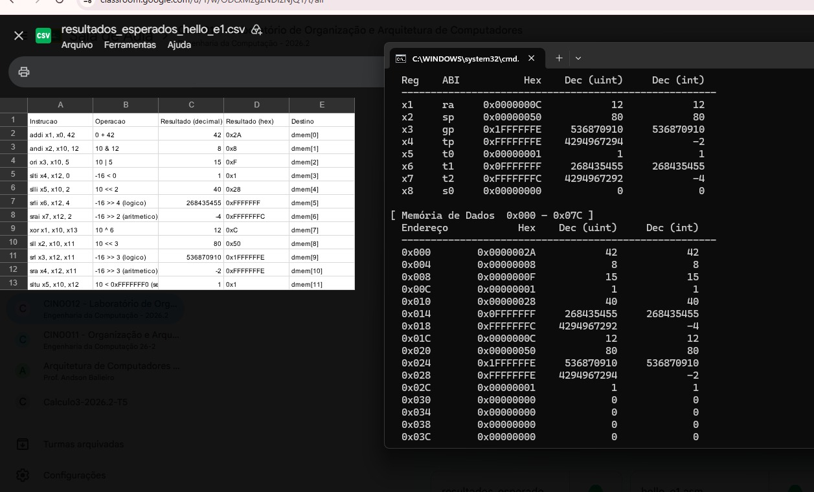
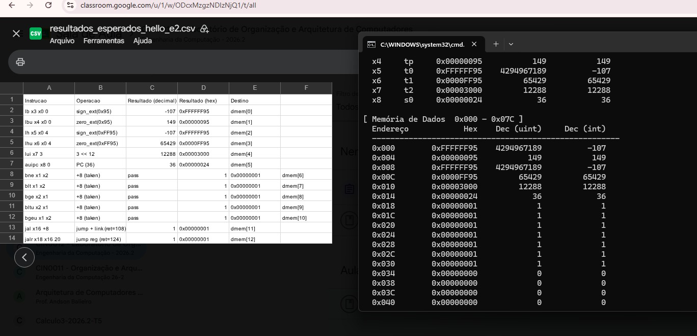

# 🖥️ Processador RISC-V RV32I com Pipeline

Projeto final de **CIN0012 – Laboratório de Organização e Arquitetura de Computadores** (CIn/UFPE, 2026.2).

---

## 📋 Sobre o Projeto

Implementação, em SystemVerilog, de um processador **RISC-V RV32I com pipeline de 5 estágios**, executado em simulação (ModelSim) e na placa FPGA **DE2-115**.

O ponto de partida foi o [projeto base](https://gitlab.com/jualabs-teaching/oac/rv32i_pipelined_base_project) fornecido pelo professor Victor Medeiros, baseado no livro de Patterson & Hennessy, que executava apenas 8 instruções.

## 🎯 Objetivo

Estender o processador base de **8 para 36 instruções**, em três entregas, **sem alterar a estrutura do pipeline**, e validar o resultado em simulação e em hardware.

## ⚡ Instruções Implementadas

| Tipo | Já existiam no base | Adicionadas por nós | Entrega |
|------|--------------------|--------------------|:-------:|
| R-type | ADD, SUB, OR, AND, SLT | XOR, SLL, SRL, SRA, SLTU | 1 |
| I-type aritmético | — | ADDI, ANDI, ORI, XORI, SLTI, SLLI, SRLI, SRAI | 2 |
| U-type | — | LUI, AUIPC | 2 |
| Loads | LW | LB, LH, LBU, LHU | 3 |
| Stores | SW | SB, SH | 3 |
| Branches | BEQ | BNE, BLT, BGE, BLTU, BGEU | 3 |
| Jumps | — | JAL, JALR | 3 |
| **Total** | **8** | **28** | **36** |

## 🛠️ Tecnologias Utilizadas

- **Linguagem de hardware:** SystemVerilog
- **Simulação:** ModelSim – Intel FPGA Starter Edition
- **Síntese e gravação:** Intel Quartus Prime Lite Edition
- **Placa:** Terasic DE2-115 (Cyclone IV E – EP4CE115F29C7)
- **Ferramentas de apoio:** Python 3 (`assembler.py` para montar os programas e `serial_dump.py` com `pyserial` para ler os resultados da placa)

## 📁 Estrutura do Projeto

```
Laboratorio-organizacao-e-arquitetura-de-computadores/
├── Projeto Risc-V/
│   ├── rv32i_pipelined_complete_project/  → código final (36 instruções)
│   │   ├── src/        → processador em SystemVerilog + testbench
│   │   ├── assembler/  → montador assembler.py
│   │   ├── modelsim/   → program.hex, data.hex e golden.txt da simulação
│   │   ├── quartus/    → projeto do Quartus e arquivos .mif da placa
│   │   └── dump/       → serial_dump.py e resultados capturados na placa
│   │
│   ├── rv32i_pipelined_base_project/      → código original (8 instruções)
│   ├── relatorio/      → este relatório e as imagens
│   └── slides/         → apresentação
│
└── testes/
    ├── etapa1/         → hello_e1.asm + resultados esperados
    ├── etapa2/         → hello_e2.asm
    ├── etapa3/         → test_all.asm + resultados esperados
    └── completo/       → teste completo escrito pela equipe
```

## 🏗️ Arquitetura

O processador segue o pipeline clássico de 5 estágios, e cada instrução avança um estágio por ciclo de clock:

```
  IF ───► ID ───► EX ───► MEM ───► WB
busca   decodifica  executa  memória  escreve
```

| Estágio | Função | Módulos |
|---------|--------|---------|
| **IF** | Busca a instrução na memória | `pl_imem` |
| **ID** | Decodifica, lê registradores, monta o imediato, detecta load-use | `pl_control`, `pl_regfile`, `pl_sign_ext`, `pl_hazard` |
| **EX** | Executa na ALU, aplica forwarding, resolve desvios e saltos | `pl_alu`, `pl_alu_ctrl`, `pl_forward` |
| **MEM** | Acessa a memória de dados ou os periféricos da placa | `pl_dmem`, `pl_mmio` |
| **WB** | Grava o resultado no banco de registradores | `pl_regfile` |

**Tratamento de conflitos (herdado do projeto base):**
- **Forwarding:** adianta resultados de EX/MEM e MEM/WB para a ALU.
- **Stall load-use:** insere 1 ciclo de bolha quando uma instrução usa o valor de um load imediatamente anterior.
- **Flush:** descarta 2 instruções quando um desvio ou salto é tomado no EX.

**Outros detalhes:** o processador roda a 10 MHz (PLL a partir dos 50 MHz da placa). Endereços de 0x000 a 0x3FF acessam a memória de dados, e a partir de 0x400 acessam chaves, LEDs, UART e contador de ciclos.

## 🚀 Entregas

### Entrega 1 – R-type (27/10)

📌 **Instruções:** XOR, SLL, SRL, SRA, SLTU
📂 **Arquivos:** `pl_alu.sv`, `pl_alu_ctrl.sv`

- **ALU:** ganhou 5 operações. Os deslocamentos usam só `rs2[4:0]`; o SRA usa `$signed(...) >>>` para preservar o sinal; o SLTU compara sem sinal.
- **Controle da ALU:** com ALUOp = 10, o `funct3` escolhe a operação, e o bit 30 separa ADD/SUB e SRL/SRA.
- O controle principal e o datapath não mudaram, porque as instruções novas usam o mesmo opcode do ADD.

### Entrega 2 – I-type e U-type (03/11)

📌 **Instruções:** ADDI, ANDI, ORI, XORI, SLTI, SLLI, SRLI, SRAI, LUI, AUIPC
📂 **Arquivos:** `pl_control.sv`, `pl_alu_ctrl.sv`, `pl_sign_ext.sv`, `pl_datapath.sv`, `pl_pipe_pkg.sv`, `pl_cpu.sv`

- **I-type:** o controle reconhece o opcode OP_IMM, liga **ALUSrc** (entrada B = imediato) e envia **ALUOp = 11**, um modo novo que decodifica só pelo `funct3`.
  - Ele é necessário porque, no I-type, os bits 31–25 fazem parte do imediato: com o ALUOp do R-type, um `addi` com imediato negativo seria executado como SUB.
  - A exceção é SRLI/SRAI, que usam o bit 30.
- **U-type:** LUI (0 + imm) e AUIPC (PC + imm) são somas. Criamos o sinal **ALUSrcA**, que escolhe a entrada A da ALU entre **rs1**, **PC** e **zero**. O gerador de imediato já entrega `imm << 12`.
  - O mux do ALUSrcA fica **depois do forwarding**, para descartar valores adiantados por engano, já que em LUI/AUIPC os bits de "rs1" são imediato.
  - `pl_pipe_pkg.sv` e `pl_cpu.sv` apenas levam o ALUSrcA do estágio ID até o EX.

### Entrega 3 – Memória, desvios e saltos (10/11)

📌 **Instruções:** LB, LH, LBU, LHU, SB, SH, BNE, BLT, BGE, BLTU, BGEU, JAL, JALR
📂 **Arquivos:** `pl_datapath.sv`, `pl_control.sv`, `pl_sign_ext.sv`, `pl_pipe_pkg.sv`, `pl_cpu.sv`

- **Loads:** no estágio MEM, `endereço[1:0]` escolhe o byte ou a meia palavra, e o `funct3` decide entre estender o sinal (LB, LH) ou completar com zeros (LBU, LHU).
- **Stores:** leitura, modificação e escrita no mesmo ciclo. Um vetor `byte_en` marca os bytes alterados, e os demais vêm da palavra atual, o que só é possível porque a memória tem leitura assíncrona.
- **Branches:** um comparador no EX, escolhido pelo `funct3` e com e sem sinal, substitui o uso do sinal `Zero` da ALU, que só testava igualdade.
- **Jumps:** JAL salta para PC + imm, e JALR para (rs1 + imm) com o bit 0 zerado, calculado pela ALU. Os dois gravam PC + 4 em rd e usam o mesmo flush dos branches.

### 🔧 Outras correções

- **`pl_mmio.sv`:** o sinal `tx_byte` era usado antes de ser declarado, o que gerava erro no ModelSim. A declaração foi movida.
- **`pl_mmio.sv`:** a UART estava configurada para 50 MHz, mas o processador roda a 10 MHz, e a serial saía a 1920 baud. Corrigimos para `CLK_HZ = 10_000_000`, e ela voltou a 9600 baud. Outra solução para esse problema seria mudar o arquivo top no quartus do pl_top.sv para o pl_top_no_ppl.sv.

## ✅ Testes e Resultados

| Teste | Autor | Cobre | ModelSim | Placa |
|-------|-------|-------|:--------:|:-----:|
| `hello_e1.asm` | professores | R-type e I-type | ✅ PASS | ✅ correto |
| `hello_e2.asm` | professores | loads, stores, U-type, branches, jumps | ✅ PASS | ✅ correto |

Os valores esperados vieram das planilhas dos professores e de um simulador de referência escrito à parte, e não do próprio processador.

### hello_e1 na placa

Os endereços 0x000 a 0x02C conferem com a planilha dos professores (à esquerda).



### hello_e2 na placa

Os registradores x3 a x8 e os endereços 0x000 a 0x030 conferem com a planilha (à esquerda).



## ▶️ Como Executar

### Simulação (ModelSim)

1. Montar o programa: `python assembler.py programa.asm` (na pasta `assembler/`).
2. Copiar o `program.hex` gerado e o `golden.txt` do programa para `modelsim/`.
3. No ModelSim, dentro da pasta `modelsim/`:

```
vlib work
vlog -sv ../src/pl_pipe_pkg.sv ../src/pl_alu.sv ../src/pl_alu_ctrl.sv ../src/pl_control.sv ../src/pl_sign_ext.sv ../src/pl_regfile.sv ../src/pl_forward.sv ../src/pl_hazard.sv ../src/pl_imem.sv ../src/pl_dmem.sv ../src/pl_uart.sv ../src/pl_mmio.sv ../src/pl_datapath.sv ../src/pl_cpu.sv ../src/pl_cpu_tb.sv
vsim work.pl_cpu_tb
run -all
```

### Placa (DE2-115)

1. Montar com dump: `python assembler.py programa.asm --dump`.
2. Copiar `instruction.mif` e `data.mif` para `quartus/`.
3. No Quartus: **Processing → Start Compilation** e depois **Tools → Programmer → Start**.
4. Na pasta `dump/`, rodar `python serial_dump.py COMx` e apertar **KEY0** na placa.

## 👥 Equipe

| Nome | Usuário |
|------|:-------:|
| Alberto Marques dos Santos | ams18 |
| Carolina Santiago de Medeiros | csm6 |
| Ianne Vitória Cruz Fernandes | ivcf |
| Lucas Ferreira Alves | lfa4 |

**Professores:** Victor Medeiros e Edna Barros
